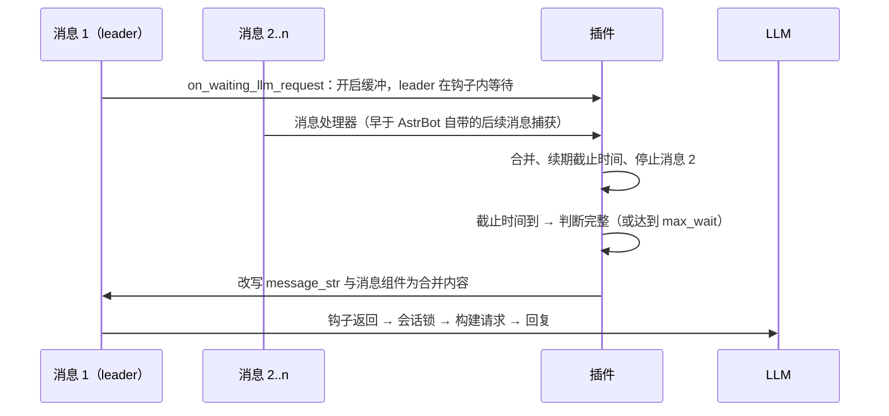

# AstrBot 消息防抖插件

> ⚠️ **注意：本插件需要 AstrBot 4.29.1+，且仅对内置 Agent 生效（Dify / Coze / DashScope 不经过防抖钩子）**
> 
<div align="center">

[](https://github.com/Type-32/astrbot-decision-delay-debouncer)
[](LICENSE)
[](https://github.com/AstrBotdevs/AstrBot)

**按阅读时间等待连续消息，再判断用户是否说完，合并后只调用一次 LLM**

</div>

---

## 📖 简介

在实际使用聊天机器人时，用户经常会分多次发送一句话：

```
用户: 如果明天不下雨
用户: 我们去爬山吧
```

传统的聊天机器人会分别处理这两句话，导致：
- ❌ 第一句话语义不完整，LLM 回复质量差
- ❌ 浪费 API 调用次数和费用
- ❌ 用户体验不佳

本插件对每位用户的连续消息做两层防抖：

1. **阅读延迟**：每条消息到达后，按"读完它所需的时间"等待（短消息约 0.8 秒，长消息、图片自动延长），期间新消息会续期，连发多条只会合并成一条。
2. **完整性判断**：等待结束后调用在线决策模型 JEV（默认经 OpenRouter）判断合并后的内容是否说完；没说完就继续等下一条，直到说完或达到最长等待时间。

- ✅ 连发、刷屏、分段输入都只触发一次 LLM 调用
- ✅ 群聊中按发送者分别合并，不会把不同人的话拼在一起
- ✅ 回复生成中又补充消息时，可中止旧回复并合并重答

---

## 🚀 功能特性

- **阅读延迟**：只有一个 `delay_seconds` 需要调，长度自适应
- **在线判断**：JEV 决策模型（默认 OpenRouter，支持图片），无需本地模型或 GPU；也可设为 `none` 只用延迟
- **按发送者合并**：群聊每位用户独立缓冲，图片、表情等组件原样保留
- **取消过时回复**：可选，中止的回复不写入对话历史
- **不重放消息**：合并内容直接写回第一条消息，其他插件、限流、内容审核只处理每条原始消息一次

---

## 📦 安装

### 方法一：通过 AstrBot 插件市场（推荐）

1. 打开 AstrBot WebUI
2. 进入「插件管理」
3. 搜索「消息防抖」
4. 点击「安装」

### 方法二：手动安装

```bash
cd AstrBot/data/plugins
git clone https://github.com/Type-32/astrbot-decision-delay-debouncer.git
```

然后在 AstrBot WebUI 中重载插件列表。

---

## ⚙️ 配置说明

### 防抖时间

每条消息的等待时间：

```
等待 = min(5 秒, max(delay_seconds, 词数 / 4 + 汉字数 / 8 + 图片数 × 1 秒))
```

| 消息 | 等待 |
|------|------|
| `Well` / `ok` / `嗯嗯` | 0.8 秒（`delay_seconds`） |
| `如果明天不下雨` | 0.9 秒 |
| 12 个单词的问题 | 3 秒 |
| 一段长文 | 5 秒（单条上限） |
| 一张图片 | 1 秒 |

新消息会把截止时间推后到"现在 + 该消息的等待"，但从第一条消息起总共不超过 `max_wait_seconds`。
等待结束后进行完整性判断：判定完整就发送；判定未完整则继续等下一条消息（或 `max_wait_seconds` 到期强制发送）。
判断期间又收到消息时，会合并后重新等待、重新判断。

### 配置项

| 配置项 | 类型 | 默认值 | 说明 |
|--------|------|--------|------|
| `enabled` | 布尔 | `true` | 是否启用插件 |
| `usage_scope` | 选择 | `both` | `both` / `group` / `private` |
| `delay_seconds` | 浮点 | `0.8` | 每条消息最短等待（秒）；`0` 关闭延迟，每条消息立即判断 |
| `max_wait_seconds` | 浮点 | `15` | 从第一条消息起的最长等待；`0` 不限 |
| `classifier_backend` | 选择 | `jev` | `jev`（在线判断） / `none`（只按延迟合并） |
| `send_threshold` | 浮点 | `0.8` | 完整性判断阈值（0-1），越高越严格 |
| `merge_group_followups` | 布尔 | `false` | 群聊中同一用户未 @ 机器人的后续消息也合并 |
| `cancel_on_new_message` | 布尔 | `true` | 回复送达前同一用户又发消息时，中止旧回复并合并重答 |
| `jev_*` | — | — | 见下方 JEV 说明 |

> 1.3.0 起 `timeout_seconds` 被 `max_wait_seconds` 取代，旧值不会迁移；本地 ONNX 模型（`model_type`）已移除。

### 群聊后续消息（`merge_group_followups`）

群聊里只有 @ 机器人、唤醒前缀或回复机器人的消息才会进入 LLM。开启此项后，
某用户有消息正在等待时，他发送的未 @ 消息也会被合并进去。
代价：等待窗口内他发给别人的话也会被合并。默认关闭。

### 取消过时回复（`cancel_on_new_message`）

回复仍在生成、尚未送达时，同一用户又发来消息：

1. 对旧消息设置 AstrBot 的单事件停止标记（与 `/stop` 相同机制，只影响这位用户的这次回复）；
2. 旧回复不写入对话历史；
3. 旧内容与新消息合并，重新走延迟与判断后一起回复。

已经流式输出给用户的文字无法撤回；非流式请求已发出的部分仍会计费。
关闭此项时交由 AstrBot 自带的处理：工具调用间隙的补充消息会并入当前回复，否则排队等待。

### 判断模型：JEV（OpenRouter）

1. 在 [openrouter.ai/keys](https://openrouter.ai/keys) 创建密钥；
2. 填入 `jev_api_key`（或设置 AstrBot 进程的环境变量 `OPENROUTER_API_KEY`，配置优先）；
3. 重载插件，管理员发送 `/debounce_test` 确认连通。其余默认值即可用：

```json
{
  "classifier_backend": "jev",
  "jev_api_key": "sk-or-...",
  "jev_base_url": "https://openrouter.ai/api/v1",
  "jev_model": "jev-latest",
  "jev_timeout_seconds": 10,
  "send_threshold": 0.8
}
```

插件调用 OpenRouter 的 [System One 接口](https://openrouter.ai/docs/api/api-reference/systemone/submit-a-system-one-request)，
用 [JEV](https://openrouter.ai/docs/guides/community/jev) 的 `noul` 问题获取“用户是否已表达完整”的概率，与 `send_threshold` 比较。
`jev-latest` 会映射到最新的 `typesafe/jev-*`；也可固定版本，如 `typesafe/jev-1.14`。
OpenRouter 网页链接中的 `~typesafe/...` 前缀 `~` 会被自动去掉。

未配置密钥、超时、HTTP 错误或返回值非法时，直接提交已合并的消息，不会丢失或卡住；
未配置密钥时插件只按阅读延迟合并。`max_wait_seconds` 是等待用户后续消息的上限，
`jev_timeout_seconds` 是单次判断的超时，两者相互独立。修改密钥或地址后需重载插件。

也可直连 TypeSafe：`jev_base_url` 填 `https://api.typesafe.ai/v1`，密钥填 TypeSafe 密钥
（或环境变量 `TYPESAFE_API_KEY`）。`jev_base_url` 支持 `/v1` 基地址或完整的 `/v1/systemone` 地址，不是 Chat Completions 接口。

### 图片与图文消息

`jev_enable_images` 默认开启，纯图片也会参与完整性判断。
连续图文消息合并时，JEV 会结合缓存中的全部图片与文字判断；合并后的消息保留每条消息的图片，
回复模型能看到所有图片。
`jev_max_images` 默认 4（范围 1–8），限制单次传给 JEV 的最近图片数量，
不会删除传给回复模型的其他图片。关闭图片判断时，纯图片直接交给回复模型，图文仅按文字判断。

图片会校正方向、取动画首帧、转换 JPEG 并缩放/留白至官方尺寸范围，原图不变。
OpenRouter 上图片以 `image_url` 内嵌在 `state.images` 中发送；直连 TypeSafe 时使用
[原生实验性图片接口](https://docs.typesafe.ai/images)的 `assets` 与 `TypeSafe-Danger-Zone-Images: true` 请求头。
图片读取失败或接口拒绝图片时，直接提交已合并的原始图片和文字。

---

## 💡 使用示例

### 场景 1：连发短消息

```
用户: Well
用户: ok          ← 0.3 秒后，续期 0.8 秒
      ↓ 0.8 秒内无新消息 → 判断 "Well\nok"：完整
LLM:  （一次回复）
```

### 场景 2：分段输入

```
用户: 如果明天不下雨
      ↓ 等待 0.9 秒 → 判断：未完整，继续等下一条
用户: 我们去爬山吧
      ↓ 等待 0.8 秒 → 判断 "如果明天不下雨\n我们去爬山吧"：完整
LLM:  好的！如果明天天气好，我们可以一起去爬山~
```

### 场景 3：回复中补充（`cancel_on_new_message`）

```
用户: 帮我写首诗
      ↓ 判断完整，开始生成 ⏳
用户: 关于秋天
      ↓ 中止旧回复（不写入历史），合并为 "帮我写首诗\n关于秋天"
LLM:  （一首关于秋天的诗）
```

### 场景 4：最长等待

```
用户: 虽然今天很累
      ↓ 判断：未完整，等待后续…
      ↓ 距第一条消息 15 秒，强制发送
LLM:  虽然今天很累，但还是要注意休息哦！
```

---

## 🐛 调试

将 AstrBot 日志级别设为 DEBUG，可看到每次判断的完整概率与合并内容：

```
[Debounce] 完整概率: 0.23
[Debounce] 完整概率: 0.88
[Debounce] 合并发送: 如果明天不下雨
我们去爬山吧
```

### 测试判断接口

管理员在聊天中发送 `/debounce_test`，插件会用当前配置发起一次真实判断（计费一次），回复结果、接口地址、模型与耗时。
WebUI 插件配置页不支持自定义按钮，因此用指令代替。

判断失败时日志为 `防抖判断失败（ValueError: JEV HTTP <状态码>: <原因>）`，原因取自 OpenRouter 返回的错误信息：

| 状态码 | 常见原因 |
|--------|----------|
| 401 | 密钥无效、被禁用或复制不完整 |
| 402 | 账户或该密钥额度不足 |
| 403 | 密钥自身的消费上限已用完、组织 Guardrail 预算/模型白名单拦截，或内容审核拦截 |
| 404 / 400 | 模型名或地址错误 |
| 429 / 5xx | 限流或服务暂时不可用 |

---

## ❓ 常见问题

### Q1: 插件会拦截其他插件的 LLM 调用吗？

**A**: 不会。插件只拦截用户发送消息触发的 LLM 请求，其他插件通过 `context.llm_generate()` 直接调用 LLM 不受影响。

### Q2: 判断需要多少费用 / 时间？

**A**: 每次判断是一次 OpenRouter 请求，按 OpenRouter 上 JEV 的价格计费；只在等待结束时判断一次（期间又收到消息才会重判），不是每条消息都判断。
网络延迟会叠加在阅读延迟之后；不需要判断时可设 `classifier_backend` 为 `none`。

### Q3: 如何调整判断的严格程度？

**A**: 修改 `send_threshold`：
- 值越大越严格（需要更高的完整概率）
- 建议范围：0.8 - 0.9

### Q4: 什么是"取消回复"功能？

**A**: 见上文[取消过时回复](#取消过时回复cancel_on_new_message)。关闭后，新消息交由 AstrBot 自带的后续消息机制处理。

---

## 🔄 工作原理

合并内容写回 **第一条消息（leader）**，不伪造、不重放消息。



| 钩子 | 作用 |
|------|------|
| 消息处理器（`custom_filter`，最低优先级） | 等待中的后续消息并入缓冲；回复未送达时触发取消 |
| `on_waiting_llm_request`（会话锁之前） | 第一条消息在此等待、判断、改写 |
| `on_llm_request` | 记录请求，取消时清除 `req.conversation` 使中止的回复不写入历史 |
| `on_llm_response` | 回复即将送达，此后不再取消 |

其他说明：

- 指令消息（如 `/reset`、`/stop`）不会被合并；等待中的消息被 `/stop` 或 `/reset` 停止时，缓存直接丢弃。
- 被合并消息中的图片等临时文件会转交给 leader，避免被提前清理。
- 插件卸载时，等待中的消息立即带着已有内容发送，不会丢失。

---

## 🤝 贡献

欢迎提交 Issue 和 Pull Request！


## 📄 许可证

[Apache License 2.0](LICENSE)


**如果这个插件对你有帮助，欢迎给个 ⭐ Star！**

</div>


